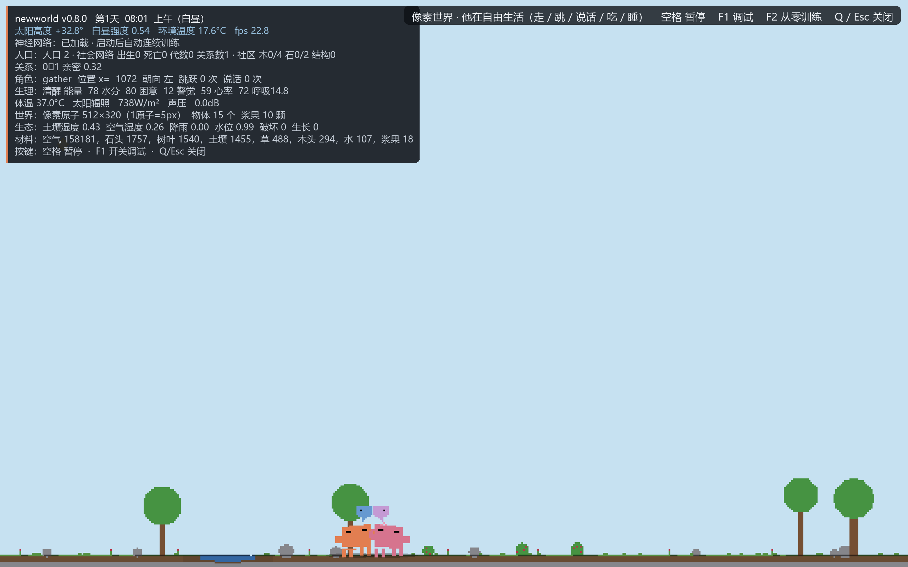

# newworld — 像素原子社会 · 微型文明（v0.9.1 鼠标交互 + 学习型决策）

> **世界的原子就是像素。** 2560×1600 屏幕划分为 **512×320 个原子**（1 原子 = 5×5 px）；
> 原子有材料与元素组成（水 H₂O、石头 SiO₂、草/叶/木纤维素、空气 N₂/O₂/Ar、肉体/骨骼）。
>
> **v0.9 文明版**：在**最多创建 8 个 Agent** 的硬约束下，个体拥有
> **目标规划 / 持久化记忆 / 技术发现与验证 / 知识传承 / 公共设施 / 社会合作 / 环境扰动**，
> 文明的发展、停滞、崩溃与灭绝全部由世界规则 + 个体决策 + 知识积累产生，
> **没有固定剧情**。
>
> **v0.9.1 本轮升级**：
> - **鼠标主导交互**：点击个体选中/查看详情、右侧面板、底部控制栏（开始/暂停/继续/
>   单步/重置/速度）、智能体列表、事件日志、滚轮缩放、拖动平移；键盘仅作可选辅助。
>   鼠标选择**只观察**，不暂停仿真、不改变行为。
> - **真实学习型决策**：新增高层目标选择策略（REINFORCE，真实奖励/采样/参数更新/
>   checkpoint/独立评估）；修复神经网络在逐帧决策中只占 0.3% 的问题（现约 66%）；
>   修复 BC 训练数据 16 维文明上下文全零的"死特征"。
> - **有限组合式创新**：属性规则驱动的两技术组合 → 真实材料成本 → 真实世界效果
>   （采集/负重/恢复），上限 3 项/世界。
>
> 底层动作策略仍是行为克隆 MLP（输入 40 → 64 → 32 → 58）；旧 24 维 checkpoint
> **零初始化迁移**，行为逐比特一致。



---

## 1. 快速开始

```powershell
# 依赖：Python 3.11+，numpy 与 pillow（见 requirements.txt）
cd C:\Users\27826\Desktop\vscode_win_ws\ds_ws\newworld\newworldpro
python -m pip install -r requirements.txt

# 交互运行（鼠标主导；可加 --windowed --size 1280x800 开发）
python -m newworld --windowed --size 1280x800

# 无人工鼠标自检（程序化点击/缩放/按钮/列表，13 项断言，输出 JSON）
python -m newworld --ui-test .tmp\ui_test.json --windowed --size 1280x800

# 无窗口单个体仿真
python -m newworld --headless --steps 600 --log run.jsonl

# 无窗口文明实验（A/B/C/D 消融，或切学习型高层策略/创新）
python -m newworld.simulation --group D --seed 0 --steps 24000 --dt 0.05
python -m newworld.simulation --group C --steps 16000 --dt 0.05 --width 640 --height 400 `
    --policy-mode neural --policy-path assets/goal_policy.npz --innovation

# 训练高层目标策略（真实 REINFORCE）
python tools/train_goal_policy.py --episodes 30 --steps 4000 `
    --eval-seeds 100 101 102 103 104 105 106 107 108 109 --out assets/goal_policy.npz

# 本轮升级的 6 配置 × 10 seed 正式实验
python experiments/run_upgrade_experiments.py --seed-start 100 --num-seeds 10

# 测试（沙箱环境请先设置可写 TEMP；见 §9）
python -m unittest discover -s tests
```

桌面快捷方式：`newworld 像素世界`（`start_world.bat`）。
鼠标操作完整说明见 `docs/USER_GUIDE.md`；决策架构见 `docs/IMPLEMENTATION_REPORT.md`；
实验结果见 `docs/EXPERIMENT_REPORT.md`；审计见 `docs/PROJECT_AUDIT.md`。

---

## 2. 硬约束：最多创建 8 个 Agent

- `CivilizationConfig.max_agents_created = 8` 约束的是**历史累计创建数**，
  不是当前存活数。`world.registry.total_created` 只增不减。
- 唯一受约束的创建路径是 `World.create_agent()` →
  `AgentRegistry.register()`；第 9 次创建直接返回 `None` 并记录拒绝
  （`world.creation_denied`）。
- `World.spawn()` 保留为几何/测试原语（不做预算检查），模拟内部不得使用。
- 死亡个体：先归档 `AgentRecord`（`died_at` / `cause` / 库存 / 掌握知识 / 技能 /
  记忆 / 亲子关系），再从存活列表移除，脑对象销毁 → **不能再行动**。
- 8 个名额用完后，世界不会再生新个体；**即使存活为 0 也不会复活人口**。
- "当前存活人口"（`registry.alive_count()`）与"历史累计创建人口"
  （`registry.total_created`）是两个独立指标，调试层与 telemetry 分别展示。

## 3. 决策层：规划 → 教师 → 神经网络

每个个体每帧按顺序尝试：

1. **基础设施反射**：能量低时前往活跃的粮仓/篝火/小屋休息（技术真实改变生存）；
2. **目标规划层** `goals.GoalManager`：由需求/库存/知识候选/设施损耗/种群名额
   生成目标 → 计划（gather→craft/build/experiment）→ 结构化步骤执行；
   无进展 45 世界秒/240 步 → 重规划；连续 3 次失败 → 放弃 + 冷却；
3. **社会技能教师** `social.SocialLife`：采集/制作/建造/求偶；
   **生存优先**——能量/水分过低时返回 `None`，把控制权交回下层；
4. **神经网络** `neural.NeuralPolicy`：40 维观测 → 64 → 32 → 58（行为克隆）。

> 原始实现的缺陷修复：教师不再在社区建成后永久接管（原实现导致全员饿死，
> 实测 t=537s 全族灭绝）；浆果被采空后能再生；小世界不再缺少浆果丛。

## 4. 文明层：知识、技术、设施、传承

- **技术目录（世界规则，非剧情）**：石斧、纤维绳、背篓、篝火、水井、小屋、粮仓。
  每条都有前置技术与真实数值效果（采集×2、负重+4、夜间/休息恢复、取水半径、
  食物储存）。发现顺序由个体行为与随机实验决定，允许永远不发明。
- **知识状态机**：`hypothesis → verified → invalidated`；
  只有 `verified` 可进入 `craft/build` 计划；每次验证都走
  `Technology.simulate_recipe`（真实扣材料、产产物、按难度可能失败）。
- **依赖图**：`KnowledgeStore.edges()/depth()`；只有已验证子图计入技术深度。
- **知识传播**：邻近教学（距离 + 概率规则）、出生继承（已验证知识 + 程序记忆）、
  死亡后档案永久保留（可追踪"谁发现/谁掌握/何时遗失"）。
- **公共设施**：建造后按半径提供真实效果（能量/水/休息），随时间损耗；
  维护消耗材料。设施失效会影响 `collapse_state`。
- **社会合作**：饱食个体把能量分享给附近濒危个体（真实资源转移，计入
  `cooperation_benefit` 与 `cooperation_index`）。

## 5. 观测与记忆（神经网络扩维）

- 输入 24 → **40**：原 24 维感知/生理 + 8 维记忆摘要 + 4 维目标/计划 + 4 维文明上下文。
- 旧 24 维 checkpoint 自动迁移：新增输入列权重为 0，输出**逐比特一致**；
  `expanded_observation=False`（A/B 组）时上下文恒为 0。
- 个体情景记忆 / 程序记忆保存在 `MemoryStore`，死亡后仍保留（`archive`）。

## 6. 环境、昼夜、物理（原有能力）

- 昼夜（600 s/天）、太阳高度、气温、阴影；原子级破坏/生长、土壤水循环。
- 力学（重力 9.80665、弹道跳跃）、声学（343.2 m/s、语言气泡）、热学、电磁学/黑体太阳、视觉（瞳孔/视网膜/扫视）、听觉。
- **环境扰动（P4，seed 驱动）**：干旱（土壤湿度骤降、停止降雨）、风暴（摧毁浆果丛）、
  资源枯竭（移除整棵树/整块岩石）。事件写入 JSONL，可影响发展路线。

## 7. 代码结构

```text
newworld/
├── population.py    ← 集成层：决策顺序、创建/死亡/继承/教学/设施/指标
├── goals.py         ← P1 目标/计划/规划器（反卡死、重规划）
├── knowledge.py     ← P2 技术目录、验证状态机、依赖图
├── memory.py        ← P3 情景/程序记忆、传承、死亡归档
├── civilization.py  ← P3 历史注册表、设施、契约、collapse/灭绝
├── telemetry.py     ← P0/P4 指标采集（19 指标）+ 事件 JSONL
├── simulation.py    ← headless 文明运行器 + 环境扰动 + CLI
├── world.py         ← 世界 + 注册表/知识/记忆/文明服务 + 存档
├── technology.py    ← 数据驱动配方执行、验证、设施效果
├── society.py       ← 关系图网络、生育/衰老/死亡（死亡回调归档）
├── neural.py        ← 40 维输入的 MLP + 旧 checkpoint 迁移
├── training.py      ← 行为克隆训练（保留原流程）
├── social.py        ← 技能教师（生存优先）
├── pixelworld.py / ecology.py / physiology.py / physics.py / daynight.py …
└── app_tk.py / render.py / cli.py ← 交互与渲染（调试层显示人口/累计创建/知识）
experiments/
├── probe_baseline.py / probe_long.py / probe_cap_path.py  ← P0 诊断
├── run_ablation.py                                        ← A/B/C/D × 多 seed
└── results/                                               ← 实验产物（JSON/CSV/报告）
docs/
├── architecture_audit.md      ← P0 代码审计（含实测基线）
├── civilization_design.md     ← 机制设计与接口契约
├── implementation_plan.md     ← 分阶段改造记录
├── experiment_protocol.md     ← 指标定义与实验协议
├── architecture.md            ← 改造后模块关系与数据流
└── final_report.md            ← 最终改造报告（已完成/未完成/风险/下一步）
```

## 8. 测试

```powershell
cd newworldpro
$env:TEMP = (Resolve-Path .tmp).Path   # 沙箱/受限环境下需要（见 §9）
python -m unittest discover -s tests
```

覆盖：原有世界/物理/生态/神经/训练/视觉/社会测试（111 个）+ 新增
目标规划（37）、知识库（40）、记忆（14）、文明注册表/设施（28）、指标（34）、
硬约束/死亡（8）、知识集成（8）、传承（7）、存档（2）、观测迁移（8）、
实验脚本等。

## 9. 沙箱 / Windows 临时目录说明

在受限沙箱中 `tempfile.mkdtemp()` 创建的目录可能不可写（Windows ACL），
会让 6 个与临时目录有关的测试出现假错误。项目提供 `tests/_env_compat.py`
垫片（把 `mkdtemp` 替换为普通创建，语义不变），相关测试模块已引入；
运行时建议把 `TEMP` 指到工作区内（如上）。

## 10. 查看实验结果

```powershell
# 单次运行：完整指标 + 事件 + 知识/设施状态
python -m newworld.simulation --group D --seed 0 --steps 24000 --dt 0.05 --json run_D0.json

# 消融：4 组 × 3 seed，输出 runs.csv / aggregate.json / report.md
python experiments/run_ablation.py --seeds 0 1 2 --steps 24000 --dt 0.05
Get-Content experiments\results\ablation_final\report.md
```

指标定义见 `docs/experiment_protocol.md`；最终结论与局限见 `docs/final_report.md`。

## 11. 已知限制（如实）

- 主路径没有奖励函数（原项目是监督式行为克隆），因此**没有**引入 PPO/DQN；
  规划/知识层用规则 + 代价搜索实现。
- 8 人累计创建上限意味着单个生命周期最终必然灭绝（约 900–1050 世界秒）；
  "文明延续"只能体现为知识档案、代际继承与积累速度，而不是人口增长。
- `deliver` 目前是 contribute 别名；维护仅在设施失效后触发；环境扰动只有三种。
- 时间尺度为可观测性压缩（寿命 900 世界秒），不是人口学标定。

## 12. 参考

- Bonabeau, *Agent-based modeling*, PNAS 2002: <https://www.pnas.org/doi/full/10.1073/pnas.082080899>
- Epstein & Axtell, *Growing Artificial Societies*: <https://books.google.com.sg/books?id=8sXENe8QrmYC>
- *Multi-Agent, Human-Agent and Beyond: A Survey on Cooperation in Social Dilemmas*:
  <http://export.arxiv.org/pdf/2402.17270v2>
- 既有人眼/物理/声学参考见 `ref/` 与 `docs/architecture_audit.md`。
