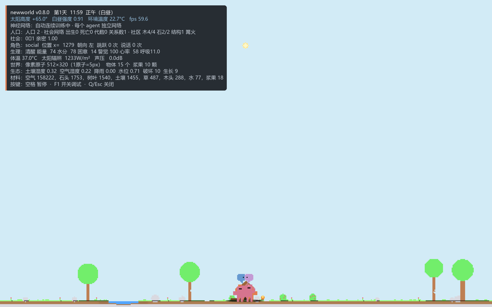

# newworld — 像素原子社会（v0.8.0）

> **世界的原子就是像素。** 2560×1600 屏幕划分为 **512×320 个原子**（1 原子 = 5×5 px）；
> 原子有材料与元素组成（水 H₂O、石头 SiO₂、草/叶/木纤维素、空气 N₂/O₂/Ar、肉体/骨骼），
> 岩石、土壤、水、树、灌木、浆果、花、草都是物理法则下自然生成的原子团。
>
> **社会版本 v0.8**：世界里有两个初始人物——**ender（男，橙色）** 和 **ender-2（女，玫瑰色 + 蝴蝶结）**。
> 他们由原始蓝图人物构成，拥有各自的神经网络；**所有 agent 组成一个社会网络**（关系图 + 图聚合网络），
> 会建立亲密关系、怀孕、生育、衰老、死亡；会**从自然界采集木头/石头、制作工具（斧头）、搭建社区（小屋 + 篝火）**。
>
> 打开程序 → **自动连续训练每个 agent 的神经网络**；**F2 → 所有 agent 从零训练**。
> 桌面快捷方式：`newworld 像素世界`。




---

## 1. 两个人物与多智能体

| 角色 | 特征 |
| --- | --- |
| ender（0 号） | 男性，橙色原始人物，四条腿 + 蓝色思考气泡 |
| ender-2（1 号） | 女性，玫瑰色身体、丁香色气泡、头顶蝴蝶结 |
| 孩子 | 由父母神经网络交叉+变异生成；体型 0.65 倍，第 1/2/… 代，随机性别 |

- 每个人物都有**独立**的 `NeuralPolicy`（自己的权重文件），不是共享一个策略。
- 孩子继承父母两套网络的交叉权重并加入变异；出生后立即拥有自己的感知与行为。
- 渲染支持多人物：不同颜色、体型、独立说话气泡和影子。

## 2. 社会网络（每个 agent 的 NN + 社会网络）

**每个人物**：24 维感知/生理输入 → 64 → 32 → 58 输出（5 行为模式 + 3 移动 + 跳/说 + 3×16 语言头）。

**社会网络**（`newworld/society.py::SocietyNetwork`）：对所有 agent 的社会状态做图聚合：

```
每个 agent 的 11 维社会/生理特征（性别、年龄、能量、水分、木材、石头、
社区进度、社区是否建成、平均亲密、代数、体型）
        + 关系图 affinity 的行归一化消息（每个 agent 是节点，亲密是边权）
        → 22 维 → 12 tanh → 6 维社会上下文
```

- 每个 agent 得到自己的 **6 维社会上下文**，写入 `character.social_context`，供其行为/调试使用。
- 关系是**动态的**：距离近会提升亲密；社会网络每步重算；调试层显示 `关系：0↔1 亲密 1.00`。
- 社会网络权重持久化到 `assets/society.npz`；F2 会重新随机化它，自动训练会继续保存。

## 3. 生育、衰老、死亡

- 成熟年龄 **70 s**；成年男女距离 <120 px、亲密 >0.55、能量充足时，女性怀孕（妊娠 **24 s**）。
- 出生：在母亲旁边生成真实新 agent（随机性别、第 N 代、体型 0.65、父母 id），孩子有自己的神经网络。
- 死亡：寿命 **900 s** 或能量耗尽；死亡后从世界与所有脑中移除。
- 人口上限 8；调试面板显示 `人口 · 社会网络 出生/死亡/代数/关系数 · 社区进度`。

## 4. 从自然界取得材料 → 工具 → 社区

- **采集**：手够到树木/岩石的原子，直接移除那个 wood/stone 原子，放入 `Inventory`（工具可翻倍采集）。
- **工具**：2 木头 + 1 石头 → **石斧**（`craft`），提高采集效率。
- **社区**：社区站点在屏幕中央；把 2 木头 +1 石头带回并 `contribute`；累计 **4 木头 + 2 石头** → 建造小屋和篝火。
- 渲染：社区地面会出现木料堆、木屋、房顶、门和篝火；调试层显示 `社区 木/4 石/2 结构/篝火`。
- 社会技能目前是**可教学教师策略**（`newworld/social.py`）：它负责采集/制作/建造/求偶的执行，神经网络负责基础行走/觅食/睡眠等行为；下一步会把技能层也训练成独立网络。

## 5. 自动训练 / F2 从零训练（多 agent）

- 打开程序：加载每个 agent 的 `assets/agents/agent_<id>.npz`（缺失时从基础 checkpoint 复制/初始化），
  后台每约 30 秒对**每个 agent** 做一轮连续训练并保存；F1 面板显示 `神经网络：训练中 · 自动连续训练中…` 与模式准确率。
- **F2**：为所有 agent 重新随机初始化网络（社会网络也重置），从零预训练每人的网络，覆盖各自 checkpoint；之后自动训练继续。
- 训练数据来自手写 homeostatic 教师（走/觅食/吃/喝/睡），语言头学习每个内部状态的 3 音节词（原始语言）。

## 6. 生态、昼夜、物理

- 昼夜（600 s/天，太阳高度角日变化）、阴影、空气温度；白天/夜晚天空颜色、月亮、星星。
- 原子级破坏/生长：踩碎草叶→碎片；浆果/草生长；土壤湿度、蒸发、降雨、水位。
- 力学（重力 9.80665、弹道跳跃）、声学（343.2 m/s、SPL、语言气泡）、热学（Stefan–Boltzmann、体温）、
  电磁学/黑体太阳、视觉（瞳孔/视网膜/扫视）、听觉。

## 7. 中文调试层（示例）

```text
newworld v0.8.0   第1天 11:59  正午（白昼）
太阳高度 +65.0°  白昼强度 0.91  环境温度 22.7°C  fps 59.6
神经网络：训练中 · 连续训练完成·第1轮·2个agent 模式准确率 0.93
人口：人口 2 · 社会网络 出生0 死亡0 代数0 关系数1 · 社区 木4/4 石2/2 结构1 篝火
关系：0↔1 亲密 1.00
角色：social  位置 x=1279 ...
生态：土壤湿度 ... 破坏 ... 生长 ...
```

## 8. 运行

```powershell
# 双击桌面快捷方式（自动连续训练）
cd C:\Users\27826\Desktop\vscode_win_ws\ds_ws\newworld\newworldpro
python -m newworld --neural --debug

# F1 调试 / F2 从零训练全部 agent / 空格暂停 / Q 退出

python -m newworld --preview
python -m newworld --headless --steps 600 --log run.jsonl
python -m unittest discover -s tests
python tools/train_neural_policy.py --mode fine
```

## 9. 代码结构（新增部分）

```text
newworld/
├── population.py   ← 多 agent 管理：每人独立脑、社会更新、出生/死亡同步
├── society.py      ← SocietyNetwork 图网络、亲密关系、怀孕/出生/死亡
├── technology.py   ← Inventory、社区站点、采集/石斧/建造
├── social.py       ← 工具/社区/求偶的技能教师
├── art.py/body.py  ← 原始人物 + 女性配色/蝴蝶结 + 儿童缩放
├── neural.py/training.py ← 每人 MLP + 语言头 + 教师模仿
├── app_tk.py       ← 多人物渲染、F1 中文、F2 从零训练、自动连续训练
└── render.py       ← 多人物、社区小屋/篝火、调试层
assets/
├── agents/agent_<id>.npz   ← 每人独立网络
├── society.npz             ← 社会网络
├── neural_policy.npz       ← 基础网络
└── 预览图
```

## 10. 验证

- `python -m unittest discover -s tests` → **111 tests OK**（社会/图网络/生育死亡/工具社区/身体/生态/神经/训练/物理/视觉/CLI/预览）。
- 实机：两个人物、女性外观、独立气泡、出生儿童、社区建成、调试行。
- 自动训练启动 → 每个 agent 一轮训练完成（模式准确率约 0.93）。
- F2 从零训练路径已实现（`Population.reset_policies` + `pretrain` 每人网络）。

## 11. 参考（社会仿真/协作/工具文化）

- Bonabeau, *Agent-based modeling: Methods and techniques for simulating human systems*, PNAS 2002:
  <https://www.pnas.org/doi/full/10.1073/pnas.082080899>
- Epstein & Axtell, *Growing Artificial Societies*:
  <https://books.google.com.sg/books?id=8sXENe8QrmYC>
- *Multi-Agent, Human-Agent and Beyond: A Survey on Cooperation in Social Dilemmas*:
  <http://export.arxiv.org/pdf/2402.17270v2>
- *From individual decisions to team emergence: a survey on explainable cooperative MARL*:
  <https://link.springer.com/article/10.1007/s10462-026-11598-3>
- *Multi-Agent Cooperation via Graph Convolutional Reinforcement Learning*:
  <https://xplorestaging.ieee.org/document/11388085>
- 社会学习与工具文化：<https://www.nature.com/articles/s41599-021-00829-3.pdf>、
  <https://europepmc.org/backend/ptpmcrender.fcgi?accid=PMC3049103&blobtype=pdf>
- 既有人眼/物理/声学参考见前几节与 `ref/`。

## 12. 已知限制

- 工具/社区/求偶技能目前由教师规则执行；基础行为由神经网络学习；技能层尚未成为独立可训练网络。
- 社会网络是图聚合网络，但当前主要做关系上下文，不是完整的社会规范/声誉学习；育儿投资、亲属网络、资源继承仍是简化。
- 生育/死亡参数（70 s 成熟、24 s 妊娠、900 s 寿命）是为了可观察性压缩过的；不是人口学标定。
- 世界 2-D 侧视；无硬碰撞；视觉 1-D 方位角视网膜；简化生态。
